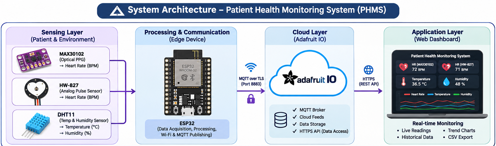
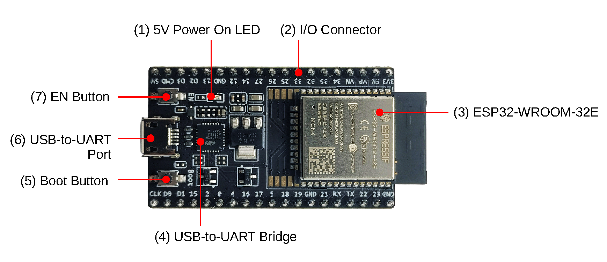
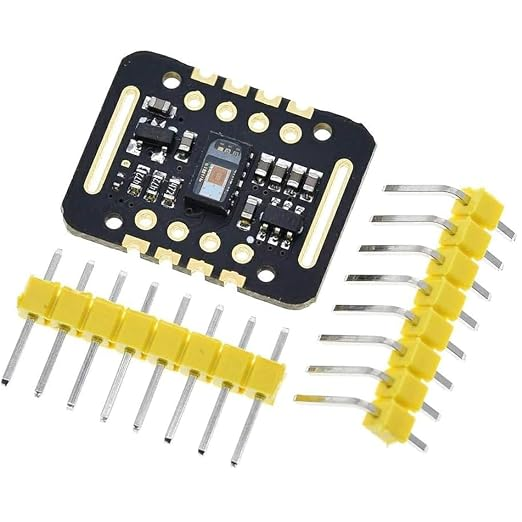
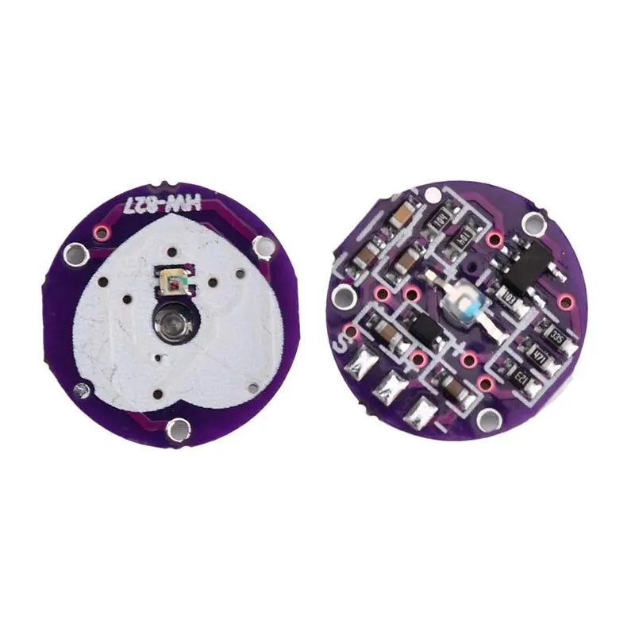
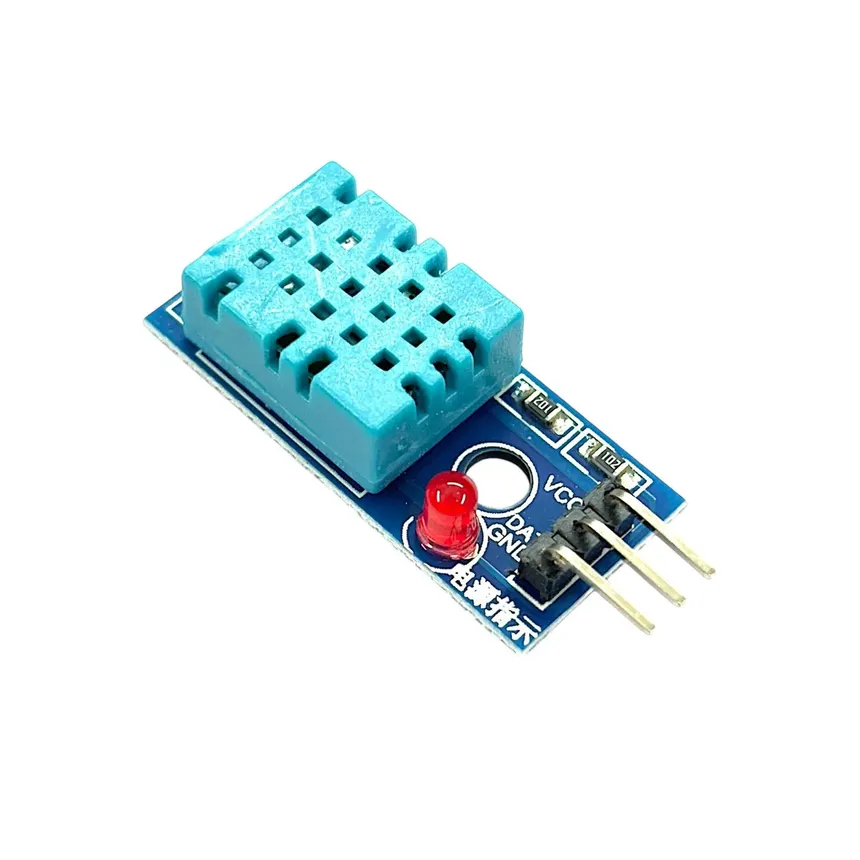
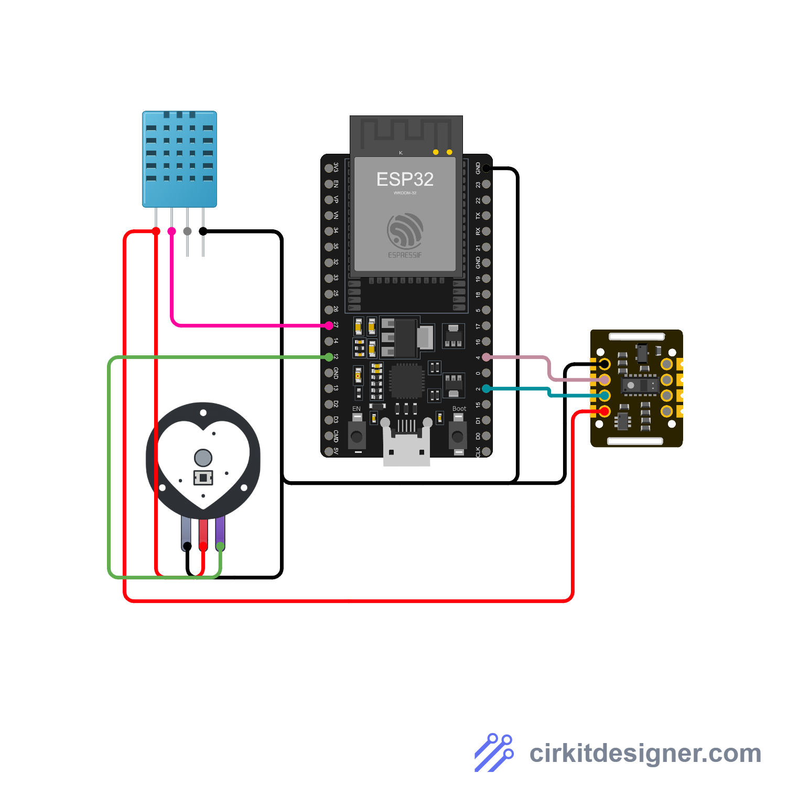
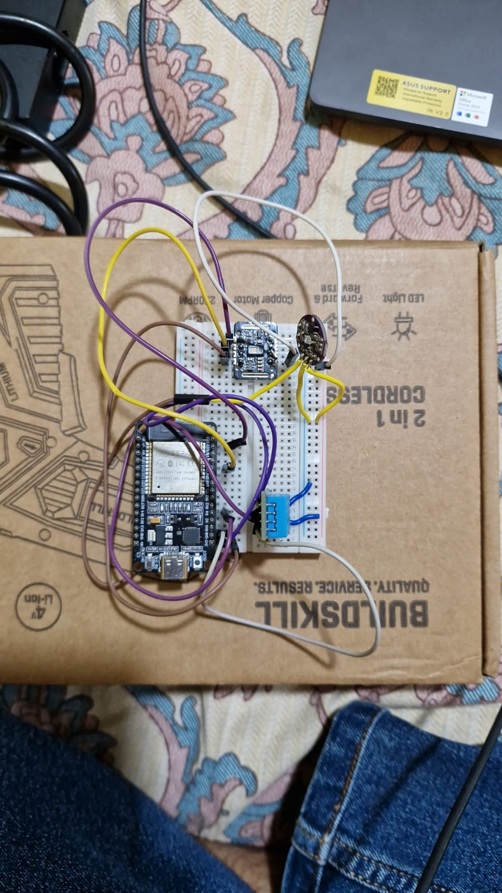
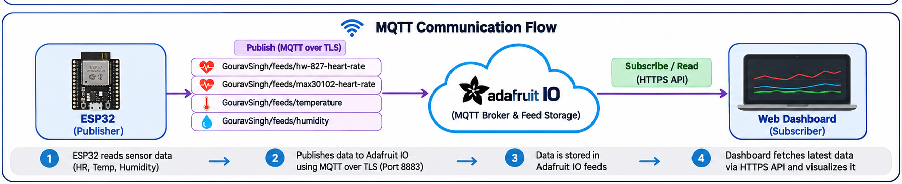
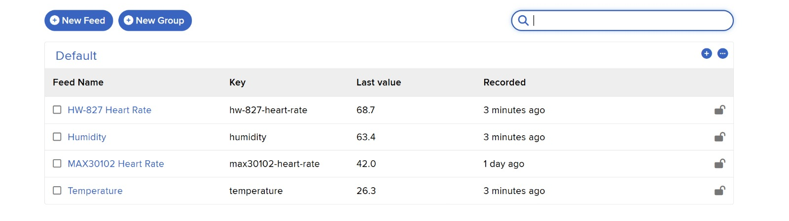
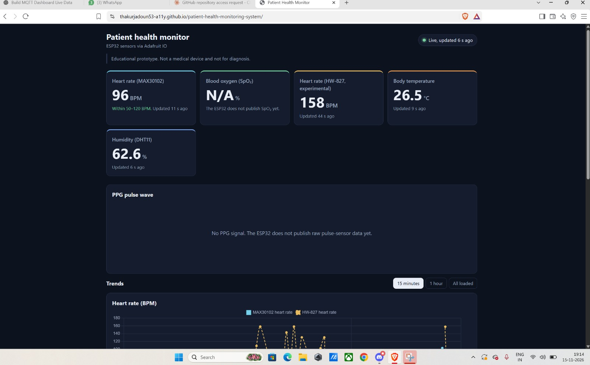

# Patient Health Monitoring System (PHMS)

An ESP32-based IoT patient and environmental monitoring prototype using the MAX30102, HW-827, and DHT11 sensors, MQTT over TLS, Adafruit IO, and a web dashboard.

> **Disclaimer:** This is an educational prototype, not a certified medical device. Its readings must not be used for diagnosis, treatment, or emergency decisions.

---
## Demo Video


## Table of Contents

- [Project Overview](#project-overview)
- [System Architecture](#system-architecture)
- [Hardware Components](#hardware-components)
- [Hardware Connections](#hardware-connections)
- [Firmware and Signal Processing](#firmware-and-signal-processing)
- [MQTT and Adafruit IO](#mqtt-and-adafruit-io)
- [Web Dashboard](#web-dashboard)
- [Setup and Configuration](#setup-and-configuration)
- [Testing](#testing)
- [Limitations](#limitations)
- [Future Improvements](#future-improvements)

---

## Project Overview

The Patient Health Monitoring System (PHMS) collects pulse-related measurements and environmental readings using sensors connected to an ESP32. The ESP32 processes the readings and publishes them to Adafruit IO using MQTT over a secure TLS connection. A web dashboard retrieves the cloud feed data through the Adafruit IO HTTPS REST API and displays current readings, trends, and historical records.

### Measurements

- Heart rate from the MAX30102 optical sensor.
- Heart rate from the HW-827 analog pulse sensor.
- Ambient temperature from the DHT11.
- Relative humidity from the DHT11.

The two pulse sensors provide separate readings using different sensing and processing approaches.

---

## System Architecture

The PHMS architecture consists of the sensing layer, ESP32 processing layer, network/cloud communication, and dashboard application.



### Data flow

1. MAX30102 and HW-827 acquire pulse-related signals.
2. DHT11 measures ambient temperature and relative humidity.
3. ESP32 reads and processes the sensor signals.
4. ESP32 connects to Wi-Fi and publishes individual measurements to Adafruit IO using MQTT over TLS.
5. Adafruit IO stores incoming values in separate feeds.
6. The web dashboard requests the latest feed values through the HTTPS REST API.
7. The dashboard renders measurement cards, charts, and historical records.

---

## Hardware Components

### 1. ESP32 Development Board



**Role:** Main controller and communication device.

The ESP32 acquires sensor data, performs pulse-processing routines, manages the Wi-Fi connection, establishes the secure MQTT connection, and publishes measurements to Adafruit IO.

**Why it is used:** The ESP32 combines GPIO, ADC, I²C, and Wi-Fi capabilities in one low-cost development platform, reducing the need for a separate wireless module.

### 2. MAX30102 Optical Heart Rate Sensor



**Role:** Optical pulse sensing.

The MAX30102 contains red and infrared LEDs and a photodetector. Changes in reflected light are used to detect pulse-related variations. The current firmware reads the infrared signal and uses the `checkForBeat()` function to detect beats and estimate BPM.

**Why it is used:** It provides a compact digital optical sensor interface over I²C and allows the prototype to demonstrate optical pulse measurement.

**Firmware scope:** The current implementation estimates heart rate. It does not calculate SpO₂.

### 3. HW-827 Analog Pulse Sensor



**Role:** Additional pulse measurement through an analog output.

The ESP32 samples the HW-827 output using its ADC. Firmware baseline tracking and threshold-based beat detection are used to estimate the time between beats and calculate BPM.

**Why it is used:** It provides a second pulse-sensing method and allows comparison between an analog pulse sensor and the MAX30102 digital optical sensor.

### 4. DHT11 Temperature and Humidity Sensor



**Role:** Environmental temperature and relative humidity measurement.

The DHT11 sends digital temperature and humidity readings to the ESP32.

**Why it is used:** It provides a simple, low-cost way to include environmental measurements in the IoT monitoring dashboard.

**Important:** DHT11 measures ambient air temperature. It is not a clinical body-temperature sensor.

---

## Hardware Connections

The following pin assignments are taken from the firmware configuration.

| Component | Signal | ESP32 GPIO |
|---|---|---:|
| DHT11 | DATA | GPIO 4 |
| HW-827 | Analog output | GPIO 34 |
| MAX30102 | SDA | GPIO 21 |
| MAX30102 | SCL | GPIO 22 |



### Wiring precautions

- Verify the pin labels and supply-voltage requirements of each breakout before connecting it.
- Ensure that the HW-827 analog output does not exceed the ESP32 ADC input voltage range.
- Connect the sensor grounds and ESP32 ground together.
- Confirm whether a breakout board includes its own voltage regulation or level shifting; do not assume all modules are 5 V tolerant.

### Actual hardware implementation



---

## Firmware and Signal Processing

The ESP32 firmware uses the Arduino framework and the following libraries:

| Library | Purpose |
|---|---|
| `WiFi.h` | Wi-Fi connectivity |
| `WiFiClientSecure.h` | TLS-secured network connection |
| `PubSubClient.h` | MQTT client |
| `Wire.h` | I²C communication |
| `DHT.h` | DHT11 sensor interface |
| `MAX30105.h` | MAX30102/MAX3010x sensor interface |
| `heartRate.h` | Beat detection routines |

### MAX30102 processing

The firmware:

1. Reads the infrared value from the sensor.
2. Checks for a beat using `checkForBeat()`.
3. Calculates BPM from the interval between detected beats.
4. Accepts BPM values within the configured 40–200 BPM range.
5. Smooths the accepted values using a moving average of the latest four readings.
6. Treats the reading as invalid when the configured no-beat timeout is reached.
7. Uses an infrared threshold to identify a likely no-finger condition.

### HW-827 processing

The firmware:

1. Reads the analog signal through GPIO 34.
2. Tracks the resting signal using an exponential moving baseline.
3. Detects a beat when the signal crosses the configured threshold.
4. Uses a lower reset threshold to reduce repeated detections.
5. Calculates BPM from the interval between accepted beats.
6. Accepts beat intervals from 300 ms to 2000 ms, corresponding approximately to 200–30 BPM.
7. Expires the reading if no valid beat is detected within the configured timeout.

### DHT11 acquisition

The DHT11 is read at approximately two-second intervals. The firmware considers readings stale if they are not refreshed within the configured validity period.

### Publishing schedule

The firmware publishes one feed per publishing cycle using a round-robin schedule.

- Publishing cycle interval: approximately 2.5 seconds.
- Number of feeds: four.
- Approximate update interval per individual feed: 10 seconds.

The firmware also includes Wi-Fi reconnection handling, MQTT reconnection handling, MQTT keepalive configuration, and periodic serial diagnostics.

---

## MQTT and Adafruit IO

The ESP32 is the MQTT publisher. Adafruit IO provides the MQTT broker and cloud feed storage.



### MQTT connection

| Parameter | Configuration |
|---|---|
| Broker | `io.adafruit.com` |
| Port | `8883` |
| Protocol | MQTT over TLS |
| Client library | PubSubClient |
| Publisher | ESP32 |
| Cloud service | Adafruit IO |

The firmware uses `WiFiClientSecure` with a configured root CA certificate to verify the TLS connection.

### Adafruit IO feeds

The firmware publishes numerical values to four separate feeds:

| Measurement | Feed name |
|---|---|
| HW-827 heart rate | `hw-827-heart-rate` |
| MAX30102 heart rate | `max30102-heart-rate` |
| Ambient temperature | `temperature` |
| Relative humidity | `humidity` |

The configured topic format is:

```text
GouravSingh/feeds/hw-827-heart-rate
GouravSingh/feeds/max30102-heart-rate
GouravSingh/feeds/temperature
GouravSingh/feeds/humidity
```

The firmware publishes individual numerical feed values, not a combined JSON telemetry message.

### Why MQTT?

MQTT is a lightweight publish/subscribe messaging protocol suited to embedded devices. It reduces communication overhead and is supported by Adafruit IO. TLS provides transport encryption and certificate-based server verification.

### Cloud dashboard screenshot



---

## Web Dashboard



The web dashboard presents the measurements stored in Adafruit IO.

Its interface includes:

- Separate heart-rate cards for MAX30102 and HW-827.
- Ambient temperature and humidity cards.
- Trend charts using Chart.js.
- Historical measurement records.
- CSV export.
- A data freshness/connection status indicator.

### Dashboard communication model

The dashboard does not directly subscribe to MQTT. The communication paths are different:

**Device publishing:**

```text
ESP32 -- MQTT over TLS (port 8883) --> Adafruit IO
```

**Dashboard data retrieval:**

```text
Web Dashboard -- HTTPS REST API --> Adafruit IO
```

The dashboard polls the latest feed values approximately every five seconds. It also requests historical feed data with a configured history limit of 100 records.

The dashboard uses a 45-second stale-data threshold to identify readings that have not been refreshed recently.

---

## Setup and Configuration

### 1. Hardware

Connect the sensors to the ESP32 using the pin assignments in the Hardware Connections table. Check supply voltage, ground connections, and analog input limits before powering the board.

### 2. Arduino IDE

Install ESP32 board support and the libraries listed in the Firmware and Signal Processing section. Select the correct ESP32 board and serial port.

### 3. Wi-Fi credentials

Set the Wi-Fi SSID and password in the firmware. Do not commit real credentials to a public repository.

### 4. Adafruit IO credentials

Configure the Adafruit IO username and active key in the firmware. The firmware configuration uses the username `GouravSingh`, the host `io.adafruit.com`, and port `8883`.

Keep the active Adafruit IO key private. Use placeholders in source files committed to GitHub.

### 5. Adafruit IO feeds

Create or verify these feeds in the configured Adafruit IO account:

- `hw-827-heart-rate`
- `max30102-heart-rate`
- `temperature`
- `humidity`

The feed names and username in the firmware must match the Adafruit IO account configuration.

### 6. Dashboard

Configure the dashboard to use the corresponding Adafruit IO feeds and HTTPS API access. Serve the HTML, CSS, and JavaScript files through a local web server or suitable static hosting service.

---

## Testing

Use the following checks during prototype validation:

| Test | What to verify |
|---|---|
| ESP32 startup | Initialization messages appear in Serial Monitor |
| Wi-Fi | ESP32 connects to the configured network |
| MQTT/TLS | ESP32 establishes a secure connection to Adafruit IO |
| MAX30102 | Sensor is detected and pulse readings are processed |
| HW-827 | Analog input changes and beat detection responds |
| DHT11 | Temperature and humidity readings are received |
| Feed publishing | Values arrive in the correct Adafruit IO feeds |
| Dashboard | Latest readings appear in the correct cards |
| History | Historical values are displayed |
| CSV export | Exported file contains available history |

These are recommended validation checks; they should only be marked as passed after being performed on the actual hardware and deployment.

---

## Limitations

1. The current MAX30102 firmware calculates heart rate but does not calculate SpO₂.
2. DHT11 measures ambient temperature, not body temperature.
3. Pulse measurements can be affected by movement, sensor placement, contact pressure, and ambient conditions.
4. The HW-827 uses threshold-based analog beat detection and may require tuning.
5. The system depends on Wi-Fi and Adafruit IO availability for cloud updates.
6. The dashboard uses periodic HTTPS polling rather than a direct MQTT browser subscription.
7. This prototype has not been clinically validated and is not a substitute for certified medical equipment.

---

## Future Improvements

- Add an appropriately validated SpO₂ measurement implementation.
- Integrate a suitable body-temperature sensor if clinical body-temperature monitoring is required.
- Improve pulse filtering and beat detection.
- Add patient/session identification.
- Add configurable alerts and notifications.
- Add local data buffering during network outages.
- Improve historical analysis and reporting.
- Evaluate measurements against suitable reference instruments.
- Develop a reliable enclosure and improve electrical/mechanical robustness.

---

## Technologies Used

| Category | Technology |
|---|---|
| Microcontroller | ESP32 |
| Optical pulse sensor | MAX30102 |
| Analog pulse sensor | HW-827 |
| Environmental sensor | DHT11 |
| Embedded framework | Arduino |
| Device communication | Wi-Fi |
| Messaging protocol | MQTT over TLS |
| Cloud platform | Adafruit IO |
| Dashboard data access | HTTPS REST API |
| Frontend | HTML, CSS, JavaScript |
| Charts | Chart.js |

---

## Disclaimer

This project is intended for educational and IoT prototyping purposes. It is not a certified medical device and must not be used to diagnose, treat, cure, or prevent any disease. Do not rely on this prototype for emergency monitoring or clinical decisions.
