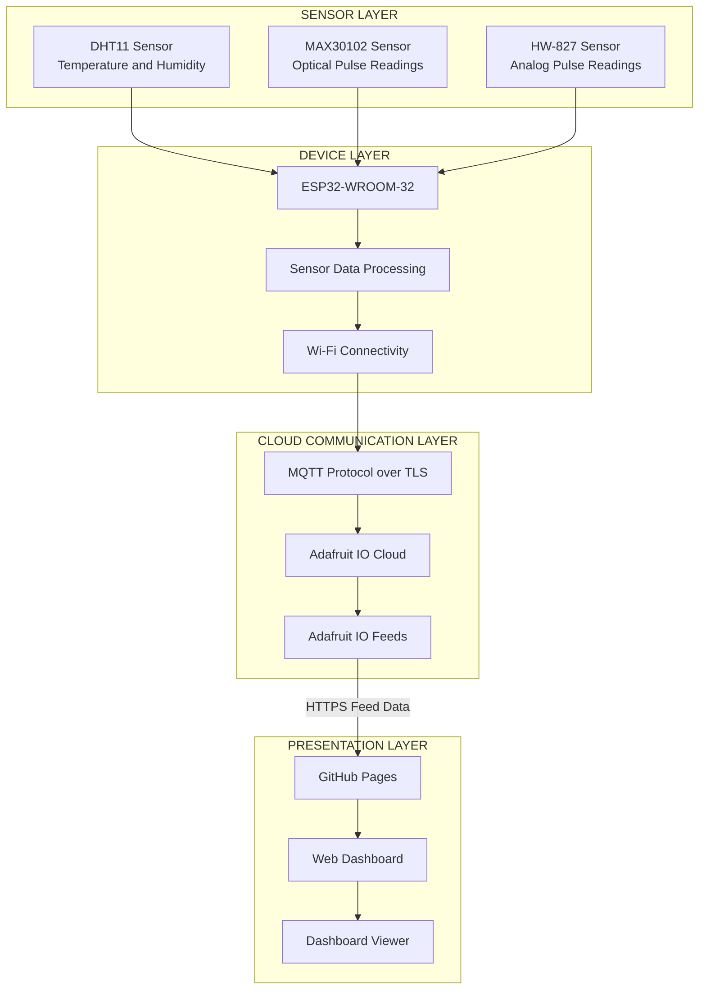

# SYSTEM ARCHITECTURE DIAGRAM

## Patient Health Monitoring System Using ESP32 and MQTT

**Prepared By:** Kumar Garv  
**Roll Number:** 2400320310096  
**Department:** Electronics & Communication Engineering  
**Institution:** ABES Engineering College  

---

## 1. Introduction

The Patient Health Monitoring System is an IoT-based prototype designed to collect sensor readings using an ESP32 microcontroller and transmit the collected data to Adafruit IO using the MQTT protocol.

The system consists of three main layers: the sensor and hardware layer, the cloud communication layer, and the web dashboard layer.

## 2. System Architecture

The following diagram represents the complete data flow of the proposed system.

## 3. Architecture Components

### 3.1 Sensor Layer

This layer contains the sensors connected to the ESP32 microcontroller.

- **DHT11:** Measures temperature and humidity.
- **MAX30102:** Provides optical readings used for heart-rate estimation.
- **HW-827:** Provides analogue pulse-related readings.

### 3.2 Device Layer

The ESP32-WROOM-32 acts as the main controller.

Its responsibilities include:

- Reading sensor data.
- Processing available sensor readings.
- Establishing Wi-Fi connectivity.
- Publishing valid measurements to Adafruit IO.

### 3.3 Cloud Communication Layer

Adafruit IO is used as the cloud platform.

- MQTT is used for communication between ESP32 and Adafruit IO.
- MQTT communication uses TLS.
- Sensor readings are published to their respective Adafruit IO feeds.
- Adafruit IO stores the received feed values.

### 3.4 Presentation Layer

The presentation layer provides a web-based dashboard.

- GitHub Pages hosts the dashboard.
- JavaScript retrieves public Adafruit IO feed data through HTTPS.
- The dashboard displays the latest available sensor readings.
- Users can view the readings through a web browser.

## 4. Data Flow Description

1. DHT11, MAX30102, and HW-827 collect sensor readings.
2. ESP32 receives and processes the sensor data.
3. ESP32 connects to the internet through Wi-Fi.
4. ESP32 publishes valid readings to Adafruit IO using MQTT over TLS.
5. Adafruit IO stores the received readings in separate feeds.
6. The web dashboard retrieves the latest public feed values through HTTPS.
7. The dashboard displays the available readings to the user.

## 5. Communication Details

| Communication | Protocol | Purpose |
|---|---|---|
| Sensors to ESP32 | GPIO, ADC, I2C | Sensor data acquisition |
| ESP32 to Adafruit IO | MQTT over TLS | Sensor data publishing |
| Dashboard to Adafruit IO | HTTPS | Feed data retrieval |
| Browser to GitHub Pages | HTTPS | Dashboard hosting and access |

## 6. System Output

The dashboard is designed to display:

- Temperature (°C)
- Humidity (%RH)
- MAX30102-based heart-rate estimate (BPM)
- HW-827-based pulse-rate estimate (BPM)

Only readings actually received and validated by the system should be displayed as current measurements.

## 7. Conclusion

The architecture demonstrates how an ESP32-based IoT system can collect sensor readings, communicate with Adafruit IO using MQTT, and display available data through a web-based dashboard.

This project is an educational prototype and is not intended for medical diagnosis or replacement of professional medical equipment.

---

**Document:** System Architecture Diagram  
**Project:** Patient Health Monitoring System Using ESP32 and MQTT  
**Prepared by:** Kumar Garv
