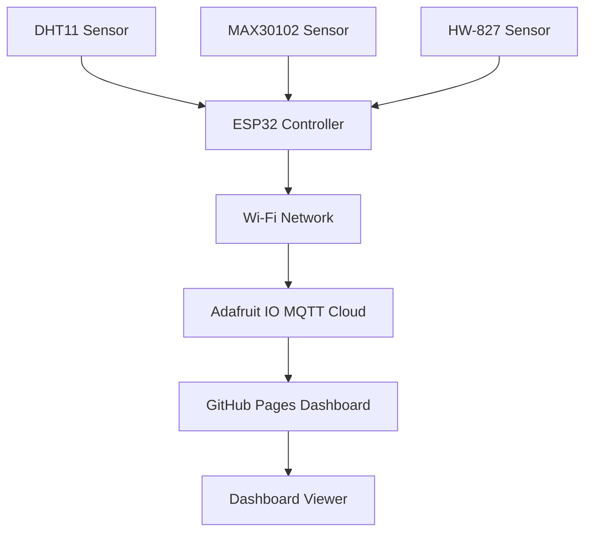
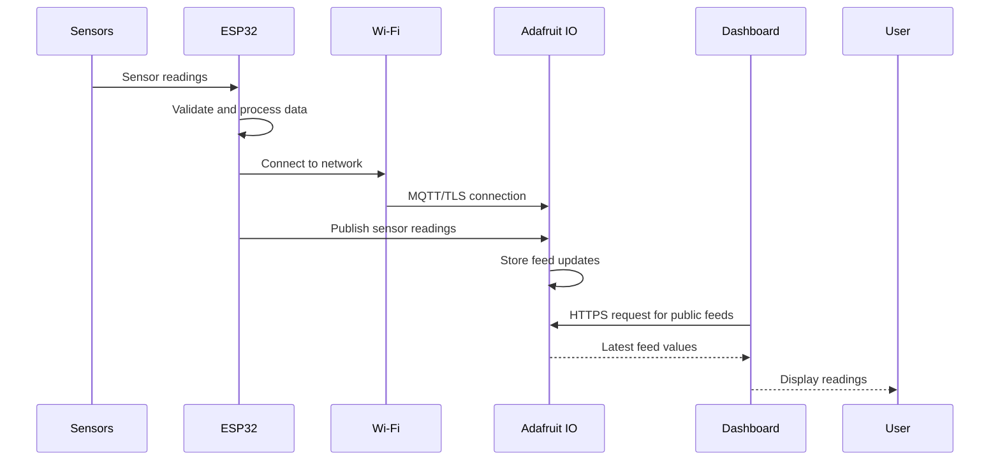

# SOFTWARE REQUIREMENTS SPECIFICATION (SRS)

# PATIENT HEALTH MONITORING SYSTEM

### An ESP32-Based IoT Prototype with Cloud Dashboard

**Institution:** ABES Engineering College, Ghaziabad

**Department:** Electronics & Communication Engineering

**Prepared By:** Kumar Garv

**Roll Number:** 2400320310096

**Degree / Year:** B.Tech, Third Year

**Project Type:** Individual Project

**Project Guide:** ____________________

**Academic Year:** 2026–2027

**Submission Date:** 15 November 2026

**Document Version:** 1.0 – Draft for Academic Review

**Standard:** IEEE Std 830-1998 Style Academic SRS

---

# DOCUMENT REVISION AND APPROVAL HISTORY

| Version | Date | Description | Prepared By |
|---|---|---|---|
| 0.1 | 01/10/2026 | Initial draft based on ESP32 and dashboard workflow | Kumar Garv |
| 1.0 | 15/11/2026 | Requirements baseline for academic review | Kumar Garv |

---

# TABLE OF CONTENTS

1. Introduction
2. Overall Description
3. System Features and Functional Requirements
4. External Interface Requirements
5. Non-Functional Requirements
6. System Design and Analysis Models
7. Academic Review and Sign-Off
8. Appendix A – Verification Checklist
9. Appendix B – Items to Confirm Before Final Submission

---

# 1. INTRODUCTION

## 1.1 Purpose

This Software Requirements Specification defines the requirements for the Patient Health Monitoring System, an educational Internet of Things (IoT) prototype.

The system collects selected sensor measurements through an ESP32 microcontroller, sends readings to Adafruit IO using MQTT, and presents the received values on a web dashboard hosted with GitHub Pages.

This document is intended for the student developer, project supervisor, evaluators, and anyone reviewing or maintaining the prototype. It describes the expected system behaviour, interfaces, constraints, and testing requirements.

## 1.2 Scope of the System

The project demonstrates remote viewing of selected environmental and pulse-related measurements.

An ESP32 reads data from the following sensors:

- DHT11 Temperature and Humidity Sensor
- MAX30102 Optical Pulse Sensor
- HW-827 Pulse Sensor Module

The firmware publishes supported readings to separate Adafruit IO feeds using MQTT. The browser dashboard retrieves public feed values and displays the latest available measurements.

### In Scope

- Reading temperature and relative humidity from the DHT11 sensor.
- Reading optical pulse data from the MAX30102 and deriving a heart-rate estimate when signal checks pass.
- Reading the analogue output of the HW-827 and estimating pulse rate using the implemented threshold and timing method.
- Connecting the ESP32 to Wi-Fi.
- Connecting the ESP32 to Adafruit IO using MQTT over TLS.
- Publishing readings to four Adafruit IO feeds:
  - temperature
  - humidity
  - max30102-heart-rate
  - hw-827-heart-rate
- Retrieving public feed values in the GitHub Pages dashboard.
- Presenting available readings through a user-friendly interface.

### Out of Scope

- Clinical diagnosis or treatment recommendations.
- Emergency response services.
- Certified medical-device measurements.
- Patient account management and secure patient records.
- Relational database or custom backend server.
- SpO₂ reporting in the current firmware.
- Guaranteed continuous monitoring during Wi-Fi, cloud service, or power failure.

## 1.3 Definitions, Acronyms and Abbreviations

| Term | Meaning |
|---|---|
| ESP32 | Microcontroller board used to read sensors and communicate over Wi-Fi. |
| DHT11 | Digital temperature and relative humidity sensor. |
| MAX30102 | Optical sensor module providing red and infrared measurements. |
| HW-827 | Analogue pulse-sensor module used in this prototype. |
| MQTT | Message Queuing Telemetry Transport, a lightweight publish/subscribe protocol. |
| Adafruit IO | Cloud service used to receive, store, and expose project feed data. |
| Feed | Named Adafruit IO data stream associated with a measurement. |
| GitHub Pages | Static website hosting used to publish the dashboard. |
| TLS | Transport Layer Security used to protect network communication. |
| Telemetry | Measurement data sent from the ESP32 to the cloud service. |
| SRS | Software Requirements Specification. |
| Stale Reading | A value that has not been updated within the configured freshness interval. |

## 1.4 References

- IEEE Std 830-1998 – IEEE Recommended Practice for Software Requirements Specifications.
- Espressif ESP32 Arduino Core: https://docs.espressif.com/projects/arduino-esp32/
- Adafruit IO: https://io.adafruit.com/
- Adafruit IO MQTT API: https://io.adafruit.com/api/docs/mqtt.html
- PubSubClient: https://pubsubclient.knolleary.net/
- SparkFun MAX3010x Sensor Library: https://github.com/sparkfun/SparkFun_MAX3010x_Sensor_Library
- GitHub Pages Documentation: https://docs.github.com/en/pages

## 1.5 Document Overview

Section 2 describes the product context, users, operating environment, and constraints.

Section 3 lists the functional requirements of the system.

Section 4 describes the user, hardware, software, and communication interfaces.

Section 5 defines the non-functional requirements and verification methods.

Section 6 presents the system design and analysis models.

Section 7 provides academic approval and sign-off details.

---

# 2. OVERALL DESCRIPTION

## 2.1 Product Perspective

The system consists of three major components:

1. Embedded sensing unit
2. Cloud messaging and data service
3. Browser-based dashboard

The ESP32 collects sensor readings and publishes them to Adafruit IO using MQTT. Adafruit IO receives and stores the readings in its respective feeds. The dashboard is a static web application hosted on GitHub Pages and retrieves public feed values for display.

### System Components

| Layer | Components | Responsibility |
|---|---|---|
| Sensing / Device | ESP32, DHT11, MAX30102, HW-827 | Acquire sensor readings and prepare data. |
| Network / Cloud | Wi-Fi, MQTT over TLS, Adafruit IO | Transfer and store feed updates. |
| Presentation | HTML, CSS, JavaScript, GitHub Pages | Retrieve and display readings and status. |

### System Context and Data Flow

| Step | From → To | Data / Action |
|---|---|---|
| 1 | Sensors → ESP32 | Temperature, humidity, IR samples, and HW-827 analogue samples. |
| 2 | ESP32 → Wi-Fi | Connect to the configured wireless network. |
| 3 | ESP32 → Adafruit IO | Publish valid measurements to corresponding MQTT feeds. |
| 4 | Adafruit IO → Dashboard | Provide latest public feed values through its read API. |
| 5 | Dashboard → Viewer | Display values, units, update status, and unavailable or stale states. |

The current design does not include a separate application server or project database. Adafruit IO is used as the cloud feed service.

## 2.2 User Classes and Characteristics

| User Class | Expected Familiarity | Responsibilities |
|---|---|---|
| Project Operator / Student Developer | Basic to intermediate technical skills | Configure device, maintain firmware and feeds, inspect logs, and update dashboard. |
| Dashboard Viewer | Basic browser skills | Open the dashboard and view available readings. |
| Project Evaluator / Guide | General technical familiarity | Review requirements, implementation evidence, and test results. |

The current dashboard is intended for demonstration and read-only viewing. It is not a patient identity or clinical record management platform.

## 2.3 Operating Environment

- Device: ESP32 development board.
- Sensors: DHT11, MAX30102, and HW-827.
- Firmware Development: Arduino IDE with required ESP32 and sensor libraries.
- Network: Wi-Fi with internet access.
- Cloud Service: Adafruit IO account and configured feeds.
- MQTT Communication: MQTT over TLS on TCP port 8883.
- Dashboard: Modern browser with JavaScript enabled.
- Hosting: GitHub Pages over HTTPS.
- Development Computer: Windows PC or another computer capable of running Arduino IDE and a modern browser.

## 2.4 Design and Implementation Constraints

- ESP32 requires Wi-Fi and internet connectivity to publish cloud telemetry.
- Adafruit IO username, key, and feed keys must match the configured account.
- Credentials must not be committed to a public GitHub repository.
- Dashboard feed data can be accessed without authentication only when the corresponding feeds are publicly accessible.
- MQTT and dashboard polling must respect applicable service limits.
- Sensor readings depend on wiring, placement, sensor quality, and signal processing.
- The system does not currently use a local persistent database.
- Power loss, Wi-Fi outage, cloud outage, or browser connectivity loss can interrupt updates.

## 2.5 Assumptions and Dependencies

- Sensors are connected according to the verified project wiring.
- The ESP32 is configured with a valid Wi-Fi SSID and password.
- Adafruit IO feeds exist and account credentials are valid.
- Public feed data is accessible from the browser.
- The dashboard viewer has internet access and a supported browser.
- The project is an educational prototype and is not used to make clinical decisions.

---

# 3. SYSTEM FEATURES AND FUNCTIONAL REQUIREMENTS

Each requirement has a unique identifier. High-priority requirements are necessary for the current demonstration. Medium-priority requirements support diagnostics and usability.

## 3.1 Module 1: Sensor Acquisition

| ID | Requirement | Acceptance Criteria | Priority |
|---|---|---|---|
| FR-1.1 | ESP32 shall read temperature and humidity from DHT11. | Successful reads update both values. | High |
| FR-1.2 | ESP32 shall acquire infrared samples from MAX30102 over I²C. | Sensor initializes and samples are read. | High |
| FR-1.3 | Firmware shall estimate heart rate from MAX30102 pulse events. | Only values passing configured signal and rate checks are eligible for publishing. | High |
| FR-1.4 | ESP32 shall read the HW-827 analogue output using its configured ADC pin. | Numeric ADC samples are available to the pulse-detection routine. | High |
| FR-1.5 | Firmware shall estimate pulse rate from HW-827 signal events. | Estimate is produced only when beat timing passes configured validity checks. | High |

## 3.2 Module 2: Connectivity and Cloud Publishing

| ID | Requirement | Acceptance Criteria | Priority |
|---|---|---|---|
| FR-2.1 | ESP32 shall connect to configured Wi-Fi. | Serial output indicates connection status. | High |
| FR-2.2 | ESP32 shall connect to Adafruit IO using MQTT over TLS. | Successful connection is reported and failed attempts are retried. | High |
| FR-2.3 | Firmware shall publish temperature to the temperature feed. | Latest feed value matches the most recently published valid temperature. | High |
| FR-2.4 | Firmware shall publish humidity to the humidity feed. | Latest feed value matches the most recently published valid humidity. | High |
| FR-2.5 | Firmware shall publish MAX30102 heart rate to its dedicated feed when valid. | Invalid readings are not published as valid measurements. | High |
| FR-2.6 | Firmware shall publish HW-827 heart rate to its dedicated feed when valid. | Invalid readings are not published as valid measurements. | High |
| FR-2.7 | Firmware shall retry network connections after connection loss. | Publishing resumes after network restoration, subject to service availability. | High |
| FR-2.8 | Firmware shall limit publishing frequency to the configured schedule. | Publishing rate remains within applicable Adafruit IO account limits. | High |

## 3.3 Module 3: Dashboard and Visualization

| ID | Requirement | Acceptance Criteria | Priority |
|---|---|---|---|
| FR-3.1 | Dashboard shall retrieve the latest public temperature feed value. | Temperature card displays value and unit or an unavailable state. | High |
| FR-3.2 | Dashboard shall retrieve the latest public humidity feed value. | Humidity card displays value and percentage unit or an unavailable state. | High |
| FR-3.3 | Dashboard shall retrieve the latest MAX30102 heart-rate feed value. | Display reflects feed value and identifies the sensor source. | High |
| FR-3.4 | Dashboard shall retrieve the latest HW-827 heart-rate feed value. | Display identifies the HW-827 source separately. | High |
| FR-3.5 | Dashboard shall refresh feed data periodically. | Values refresh at the configured polling interval when online. | High |
| FR-3.6 | Dashboard shall communicate unavailable or stale feed data. | Missing or old data is not presented as a newly measured value. | High |
| FR-3.7 | Dashboard shall display a prototype-use disclaimer. | Page states that measurements are not a clinical diagnosis. | High |
| FR-3.8 | Dashboard shall not display SpO₂ as measured unless calculation and feed are implemented. | SpO₂ remains unavailable or N/A in the current version. | High |

## 3.4 Module 4: Monitoring and Diagnostics

| ID | Requirement | Acceptance Criteria | Priority |
|---|---|---|---|
| FR-4.1 | Firmware shall report Wi-Fi and MQTT connection states through Serial Monitor. | Output distinguishes connected and disconnected states. | Medium |
| FR-4.2 | Firmware shall print sensor readings and publishing outcomes. | Output includes values or an unavailable/error indication. | Medium |
| FR-4.3 | Dashboard shall distinguish current feed data from stale data. | Status is based on feed timestamp and a documented freshness threshold. | Medium |

---

# 4. EXTERNAL INTERFACE REQUIREMENTS

## 4.1 User Interface

The dashboard is a browser-based page for viewing current measurements. Each measurement should have a clear label, unit, and source sensor.

Connection or freshness status should be visible without requiring the viewer to inspect developer tools.

### Dashboard Display Requirements

- Temperature: degrees Celsius (°C).
- Humidity: percentage (%RH).
- Heart Rate: beats per minute (BPM), with source sensor identified.
- Unavailable Values: Show "Unavailable" or "No recent data".
- SpO₂: Show "Not implemented" or "N/A" in the current version.
- The page should remain usable on common desktop and mobile browser sizes.

### Evidence to Include

- Screenshot of the deployed dashboard.
- Screenshot of sensor readings.
- Screenshot of Adafruit IO feeds.
- Screenshot showing update status and prototype disclaimer.

## 4.2 Hardware Interfaces

| Component | Interface / Pin Mapping | Purpose |
|---|---|---|
| DHT11 | Digital Data: ESP32 GPIO 4 | Temperature and humidity acquisition. |
| HW-827 | Analogue Output: ESP32 GPIO 34 | Pulse waveform sampling through ADC input. |
| MAX30102 | I²C SDA: GPIO 21, SCL: GPIO 22 | Optical sensor communication. |
| ESP32 | USB / UART Serial Connection | Firmware upload and diagnostics. |
| ESP32 | Wi-Fi Radio | Cloud connectivity. |

The actual board variant, supply voltage, and sensor breakout requirements must be checked against the hardware documentation and physical wiring.

## 4.3 Software Interfaces

| Software / Library | Role |
|---|---|
| Arduino IDE and ESP32 Arduino Core | Firmware development, compilation, and upload. |
| WiFi / WiFiClientSecure | Wireless networking and TLS-enabled client connection. |
| PubSubClient | MQTT client used to publish feed values. |
| DHT Sensor Library | DHT11 measurement acquisition. |
| SparkFun MAX3010x Sensor Library | MAX30102 access and beat-detection support. |
| Adafruit IO | Cloud MQTT broker and feed service. |
| HTML, CSS and JavaScript | Dashboard structure, styling, and data retrieval. |
| GitHub Pages | Static hosting for dashboard files. |

No SQL database, ORM, custom REST backend, or separate authentication service is specified for the current implementation.

## 4.4 Communication Interfaces

| Communication Path | Protocol / Endpoint | Purpose |
|---|---|---|
| ESP32 ↔ Adafruit IO | MQTT over TLS, TCP port 8883 | Authenticated publishing to cloud feeds. |
| Browser → GitHub Pages | HTTPS | Delivery of static dashboard assets. |
| Browser → Adafruit IO | HTTPS REST API for public feed data | Retrieval of latest feed values. |
| ESP32 ↔ Sensors | I²C / GPIO / ADC | Local sensor communication and sampling. |

### MQTT Feed Pattern

The MQTT topic pattern follows:

`account-name/feeds/feed-key`

The feed keys used by this project are:

- `temperature`
- `humidity`
- `max30102-heart-rate`
- `hw-827-heart-rate`

Dashboard requests must reference the corresponding Adafruit IO account and feed keys.

---

# 5. NON-FUNCTIONAL REQUIREMENTS

| Attribute | Requirement / Target | Verification Method |
|---|---|---|
| 5.1 Performance | Dashboard refreshes values at its configured polling interval. Firmware schedule stays within cloud account limits. | Observe feed timestamps and values during a continuous test. |
| 5.2 Security | MQTT credentials are not stored in public source control. TLS certificate verification is used. | Inspect repository and firmware configuration. |
| 5.3 Privacy | Only public demonstration data is exposed. Personal information must not be published. | Review feed contents and dashboard requests. |
| 5.4 Reliability | Device retries Wi-Fi and MQTT connections after temporary disconnection. | Disconnect and restore Wi-Fi; simulate failed feed requests. |
| 5.5 Data Integrity | Feed labels, units, and sensor mappings remain consistent. | Compare MQTT feed keys and dashboard mappings. |
| 5.6 Usability | Measurements have readable labels, units, and clear unavailable/stale states. | Review dashboard on desktop and mobile. |
| 5.7 Portability | Dashboard works in modern browsers with JavaScript enabled. | Cross-browser manual testing. |
| 5.8 Maintainability | Sensor acquisition, network publishing, and dashboard retrieval remain separated into understandable modules/files. | Code review and repository inspection. |

---

# 6. SYSTEM DESIGN AND ANALYSIS MODELS

The following models describe the implemented prototype at a logical level.

## 6.1 Use Case Model

| Actor | Use Case | Description |
|---|---|---|
| Project Operator | Configure and Start Device | Enters Wi-Fi and Adafruit IO settings, powers ESP32, and checks Serial Monitor. |
| ESP32 Device | Acquire Sensor Readings | Reads connected sensors and checks whether values are suitable for publishing. |
| ESP32 Device | Publish Telemetry | Sends valid measurements to corresponding Adafruit IO feeds using MQTT. |
| Dashboard Viewer | View Latest Readings | Opens GitHub Pages dashboard and reviews available sensor values. |
| Dashboard Viewer | Check Freshness | Uses status indicators to identify missing or stale readings. |

## 6.2 Data Flow Diagram – Level 0 (Context)

### System Data Flow

- DHT11, MAX30102, and HW-827 provide sensor samples.
- ESP32 performs sensing and processing.
- Wi-Fi provides network connectivity.
- Adafruit IO receives MQTT telemetry and provides feed values.
- GitHub Pages dashboard retrieves and displays the available values.
- Dashboard viewer accesses the displayed information.

### Mermaid Context Diagram

## 6.3 Data Flow Diagram – Level 1

1. Sensor Acquisition: ESP32 reads DHT11, MAX30102, and HW-827 interfaces.
2. Validation and Calculation: Firmware checks sensor results and derives supported pulse-rate estimates.
3. Cloud Transmission: Firmware connects to Adafruit IO and publishes valid values to configured feeds.
4. Feed Retrieval: Dashboard JavaScript requests latest public feed values over HTTPS.
5. Presentation: Dashboard formats values, units, timestamps, and freshness states for the viewer.

## 6.4 Entity / Data Model

The current implementation uses Adafruit IO feeds rather than a project-managed relational database.

A conceptual feed-update record contains:

| Field | Description |
|---|---|
| Feed Key | Identifies the measurement stream, such as temperature. |
| Value | Numeric measurement published by ESP32. |
| Created Timestamp | Cloud timestamp associated with the feed update. |
| Source Device | Logical source of the update, if configured as a stored field. |

A relational ERD with users, patients, devices, and measurement tables is not applicable to the current architecture because no such database is implemented.

## 6.5 Sequence of Operations

| Order | Interaction |
|---|---|
| 1 | Sensors provide samples to ESP32. |
| 2 | Firmware validates readings and calculates supported pulse-rate values. |
| 3 | ESP32 connects to Wi-Fi and Adafruit IO using MQTT/TLS. |
| 4 | ESP32 publishes eligible values to dedicated feed topics. |
| 5 | Adafruit IO stores the feed update and timestamp. |
| 6 | Dashboard JavaScript periodically requests latest public feed values over HTTPS. |
| 7 | Dashboard updates measurement cards and freshness indicators. |

### Sequence Diagram

---

# 7. ACADEMIC REVIEW AND SIGN-OFF

| Project Guide / Coordinator | Internal Examiner | Head of Department |
|---|---|---|
| Name: __________________ | Name: __________________ | Name: __________________ |
| Signature: ______________ | Signature: ______________ | Signature: ______________ |
| Date: __________________ | Date: __________________ | Date: __________________ |

### Student Declaration

I hereby declare that this project work titled **"Patient Health Monitoring System Using ESP32 and MQTT"** has been developed by me as an individual academic project.

**Student Name:** Kumar Garv

**Roll Number:** 2400320310096

**Signature:** ____________________

**Date:** 15 November 2026

---

# APPENDIX A – VERIFICATION CHECKLIST

| Test ID | Test Procedure | Expected Result | Evidence / Status |
|---|---|---|---|
| TC-01 | Power on ESP32 with sensors connected. | Sensors initialize and startup status appears in Serial Monitor. | Record result / screenshot. |
| TC-02 | Connect ESP32 to configured Wi-Fi. | Wi-Fi status reports connected. | Record result. |
| TC-03 | Connect to Adafruit IO using MQTT/TLS. | MQTT connection succeeds and is reported. | Retain screenshot. |
| TC-04 | Publish DHT11 readings. | Temperature and humidity feeds receive new values. | Retain feed evidence. |
| TC-05 | Publish valid MAX30102 estimate. | MAX30102 feed receives a value when validity checks pass. | Record test evidence. |
| TC-06 | Publish valid HW-827 estimate. | HW-827 feed receives a value when validity checks pass. | Retain feed evidence. |
| TC-07 | Open dashboard and wait for refresh. | Dashboard displays latest available values from four feeds. | Retain screenshot. |
| TC-08 | Allow a feed timestamp to become old or simulate request failure. | Dashboard indicates stale/unavailable state. | To be tested. |
| TC-09 | Disconnect and restore Wi-Fi. | Firmware retries and resumes publishing after recovery. | To be tested. |
| TC-10 | Inspect public repository for secrets. | No Wi-Fi password or Adafruit IO key is committed. | To be verified. |

---

# APPENDIX B – ITEMS TO CONFIRM BEFORE FINAL SUBMISSION

- Confirm exact institute, department, student details, and project guide information on the cover page.
- Confirm final physical pin wiring. This document uses GPIO 4, GPIO 34, GPIO 21, and GPIO 22 as described in the project configuration.
- Confirm exact Adafruit IO account and feed keys in final code and dashboard.
- Never include the private Adafruit IO key in the report or public repository.
- Insert screenshots of the physical prototype, Arduino Serial Monitor, Adafruit IO feeds, and deployed GitHub Pages dashboard.
- Record actual test outcomes and dates. Do not mark unperformed tests as passed.
- Confirm whether the dashboard currently shows SpO₂ as a placeholder. The firmware described here does not implement SpO₂ calculation.
- If authentication, patient profiles, alerts, data export, historical charts, or a database have since been implemented, update this SRS to match the final system.

---

# END OF DOCUMENT

**Patient Health Monitoring System | Software Requirements Specification**

**Prepared by:** Kumar Garv

**ABES Engineering College | Department of Electronics & Communication Engineering**
